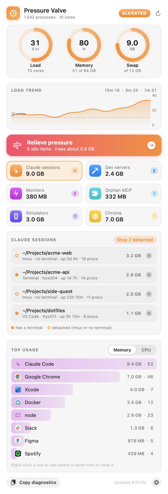
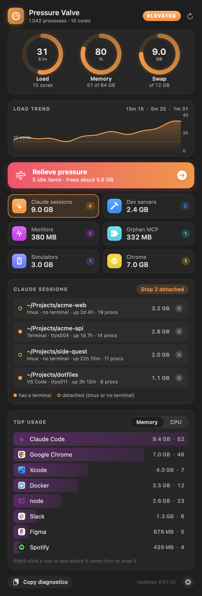

# Pressure Valve

A macOS menu bar app that shows how hard your Mac is working and stops the usual culprits with one click.

It was built for a dev machine that hit a load average of 200 with 28 GB of swap: dozens of Claude Code sessions each running their own MCP servers, forgotten Expo and Next dev servers, a booted iOS simulator and a bloated Chrome.

| Light | Dark |
|---|---|
|  |  |

## What it does

- **Menu bar ring.** The arc tracks load against core count. It turns orange when things are elevated and red when critical, with an optional notification.
- **Gauges and trend.** Load, memory and swap rings, plus a load chart for the last ten minutes.
- **Relieve pressure.** One button stops the safe targets: Activity Monitor and CleanMyMac agents, Claude Code sessions with no terminal or under tmux, and MCP servers whose parent already exited.
- **Suspect cards.** Claude sessions, dev servers, monitors, orphaned MCP servers, simulators and Chrome. Each card has per-item stop buttons.
- **Top usage.** Memory grouped by app and the top CPU processes. Right-click a row to see the full parent chain it was launched from, or to stop it.

Every kill asks for confirmation first. A process gets SIGTERM, and anything still alive after 5 seconds gets SIGKILL. API keys in command lines are redacted everywhere they are shown.

## Install

Requires macOS 14+ and the Xcode command line tools (the installer offers to add them).

```bash
git clone git@github.com:apetcu/pressure-valve.git /tmp/pv && /tmp/pv/install.sh
```

or, from a checkout, just `./install.sh`. It keeps the source in `~/.local/src/pressure-valve`, compiles the app, ad-hoc signs it, installs it into `~/Applications` and launches it. Run it again to update.

## Command line

```bash
# Text report of what it detects
~/Applications/"Pressure Valve.app"/Contents/MacOS/PressureValve --report

# Render the popover to a PNG; --demo uses made-up data (the screenshots above)
~/Applications/"Pressure Valve.app"/Contents/MacOS/PressureValve --snapshot out.png [--dark] [--select claude|dev|monitors|mcp|sim|chrome] [--cpu] [--demo]
```

## Layout

- `Model.swift` reads system stats, takes the process snapshot and finds the suspects.
- `Views.swift` holds the SwiftUI popover.
- `Demo.swift` holds the made-up data for screenshots.
- `main.swift` holds the status item, the actions and the entry point.
